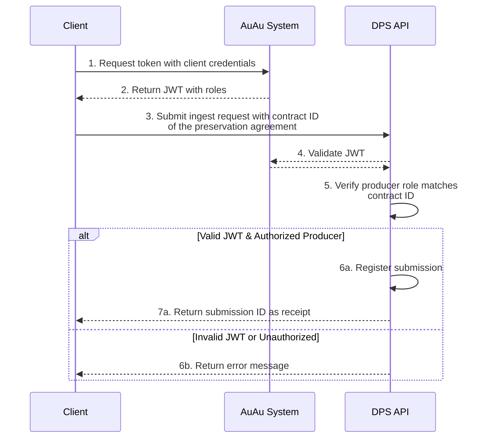
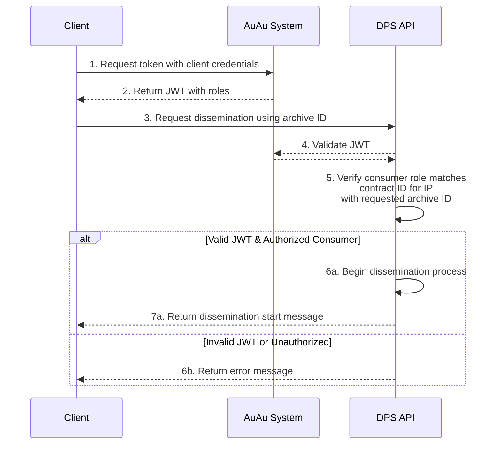
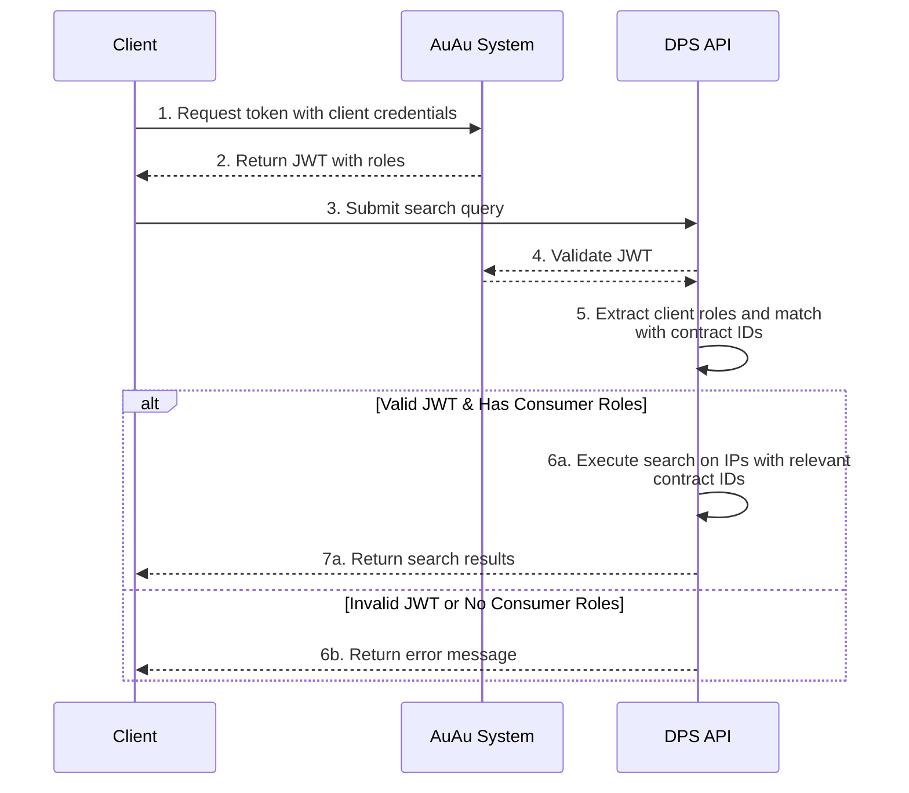

The DPS is accessed through a public API. Who can submit and retrieve content is governed by role-based access control: every client is assigned specific roles tied to preservation agreements, and those roles determine what the client is authorized to do.

The model governing access to submit data to or retrieve data from DPS has four main components: *clients*, *roles*, *preservation agreements*, and *information packages*. For context on what is submitted and retrieved, see [Data management](/docs/dps/understanding/data-management/) and [Metadata management](/docs/dps/understanding/metadata-management/).

## Clients
All users who need to communicate with the DPS will be given a client (with a clientID) by the National Library.
All clients can be assigned multiple roles.

## Roles
The roles come in two variants: *producer* and *consumer*.

A producer role gives the client rights to *submit* data to the DPS in the form of information packages, while a consumer role provides access to *retrieve* data in the form of information packages from the DPS.
Without a role the client cannot interact with the DPS.

All individual roles are in turn linked to specific preservation agreements.
Roles are assigned to clients by the National Library, in accordance to the terms of the preservation agreement.

In the API, the roles appear in the access token as `{contractId}_W` (producer, write access) and `{contractId}_R` (consumer, read access) for each preservation agreement. See [Role-Based Authorization](/docs/dps/reference/api/#role-based-authorization).

## Preservation agreement
Preservation agreements define how a given information package should be managed.
Preservation agreements are created between producers (OAIS) and the National Library.
The preservation agreement is the National Library's version of the *submission agreement*, a concept that originates from OAIS and is summarized in the E-ARK-SIP specifications[^1] as follows:

> Interactions between Producers and the OAIS are often guided by a Submission Agreement, which establishes specific details about how these interactions should take place, e.g. the type of information expected to be exchanged, the metadata the Producer is expected to deliver, the logistics of the actual transfer, statements regarding access restrictions on the submitted material, etc.

In the context of role-based access, it is not the details of these preservation agreements that are important, but rather that the preservation agreements are established in our systems.

Producer/consumer roles related to the preservation agreements are created in our authorization system.
A preservation agreement must exist *before* the submission of information packages to DPS can occur.

Preservation agreements are linked to one or more information packages. In the API, a preservation agreement is identified by its contract ID (`contractId`).

## Information packages
When data or metadata is to be submitted to or retrieved from DPS, this is done in the form of information packages.
Individual information packages are linked to one (and only one) preservation agreement.

## Archive ID
The DPS assigns an archive ID (`archiveId`) to every information package it preserves.
The archive ID is unique within our systems, and is the persistent identifier of the package in DPS.
The archive ID is sent to the party who delivered the information package when the package has been preserved, in the `submission.preserved` message.



## Example: Submit information packages
A client submitting an information package to the DPS must specify which preservation agreement should apply to the package.
One can only submit information packages linked to preservation agreements one is authorized to *produce*.
If one has the correct roles, the DPS registers the submission and returns a submission ID (`submissionId`) as a receipt. When the package has been preserved, the DPS assigns an archive ID and sends it to the client.

## Example: Request information packages
A client wishing to retrieve this information package must specify which package to retrieve using the package's archive ID.
If the client has a consumer role linked to the preservation agreement governing the relevant information package, the DPS will initiate the dissemination process.

## Example: Search for information packages
A client wishing to search for contents managed by the DPS, will be able to search all information packages connected to the preservation agreements for which they have a consumer role.

[^1]: [E-ARK SIP: 4.1. Submission Agreements](https://earksip.dilcis.eu/#submissionagreements)
