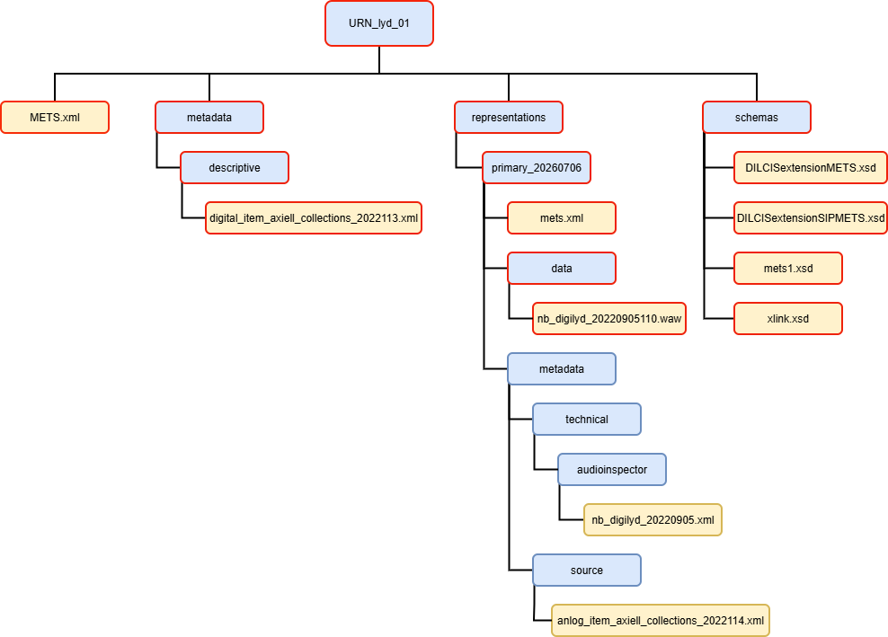

## Eksempel på SIP for lyd

## Normal use-case

  
    
      
        
      
      
        
      
    
    
    
      
        
          
        
        
          
            
              
              
            
          
          
            
          
        
        
      
    
    
      
      
      
      
      
      
    
  


### Option: access representation stored alongside primary representation

  
    
      
        
      
      
        
      
    
    
    
      
        
          
        
        
          
            
              
              
            
          
          
            
          
        
        
      
      
        
          
        
        
          
            
          
          
            
              
              
            
          
        
        
      
    
    
      
      
      
      
      
      
    
  


### Eksempel på SIP for lyd: 


  
    
    
      
        
      
    
    
      
        
        
          
        
        
          
            
              
            
          
          
            
          
        
      
    
    
      
      
      
      
    
  


**Forklaring av symboler:**
- **Blå ruter:** Mapper
- **Gule ruter:** Filer
- **Røde rammer:** Viser elementer som er omfattet av MÅ-krav i pakkestrukturen.