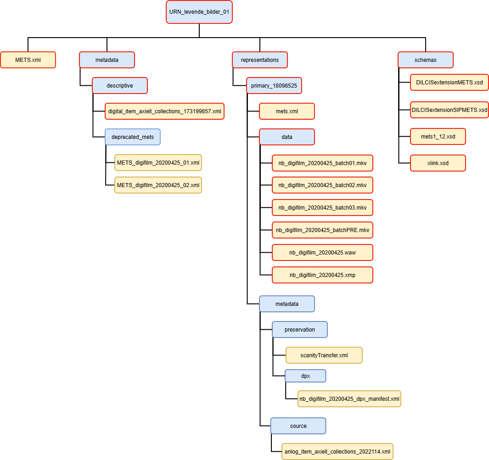

## Example of moving images SIP


  
    
    
      
        
        
          
          
        
      
    
    
      
        
        
          
          
          
          
          
          
        
        
          
            
            
              
            
          
          
            
          
        
      
    
    
      
      
      
      
    
  


<!--
Previous drawing, replaced by the filetree above. Kept for reference.

**Explanation of symbols:**
- **Blue boxes:** Folders
- **Yellow boxes:** Files
- **Red borders:** Indicate elements subject to mandatory (MUST) requirements in the package structure.
  
-->
